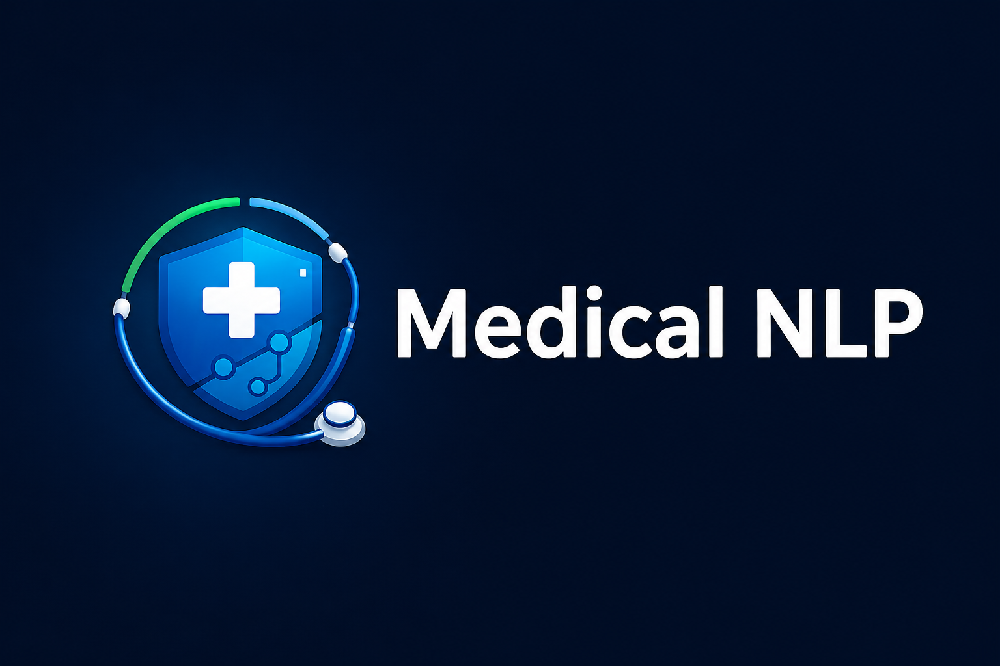
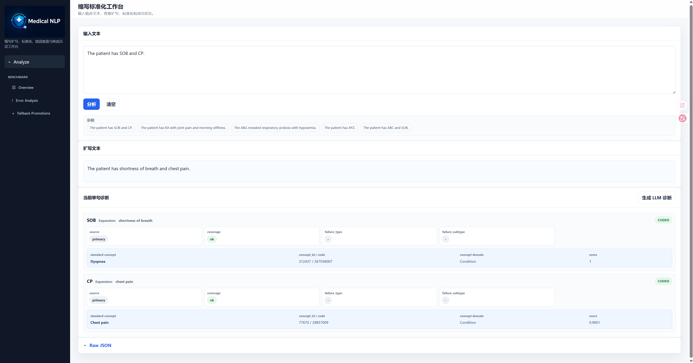
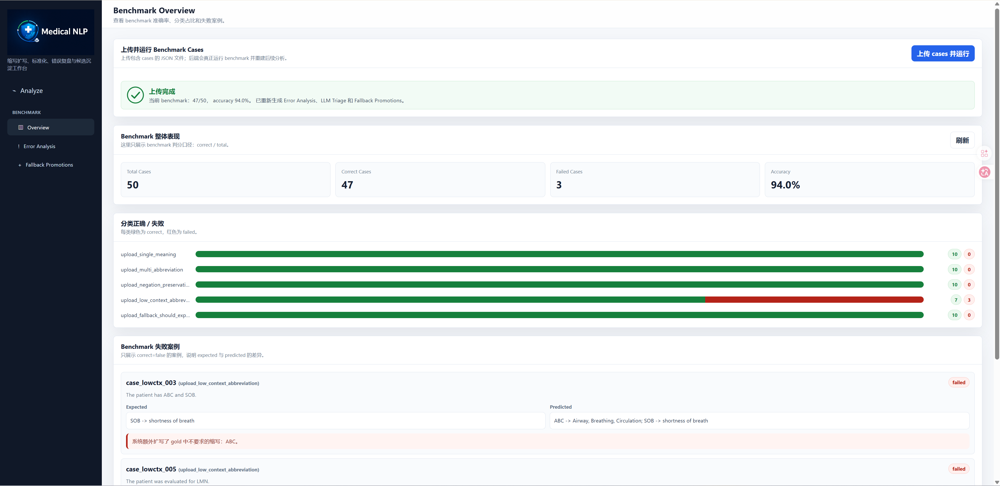
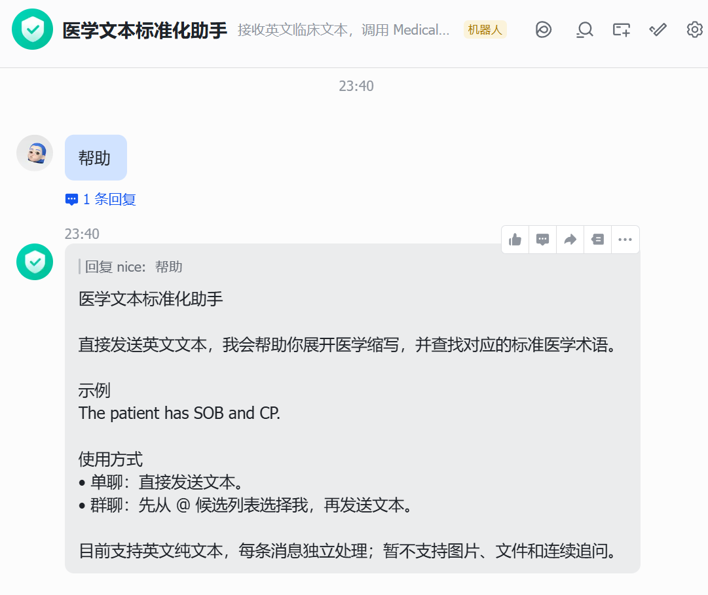
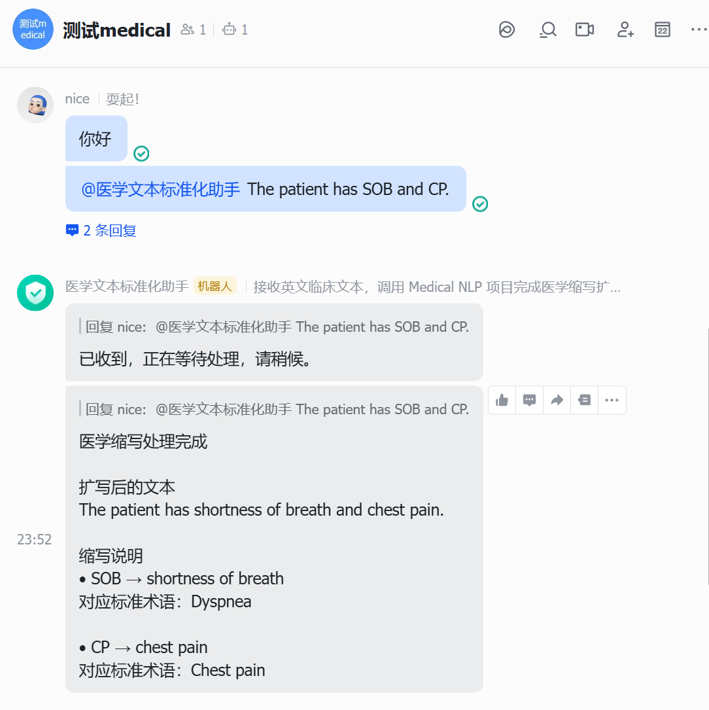
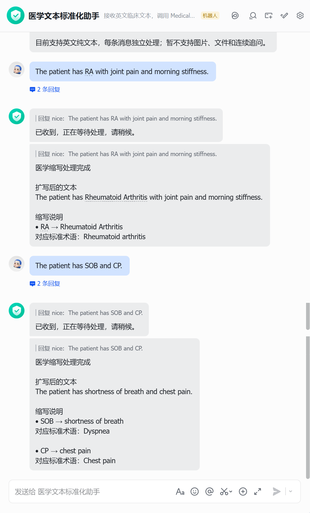
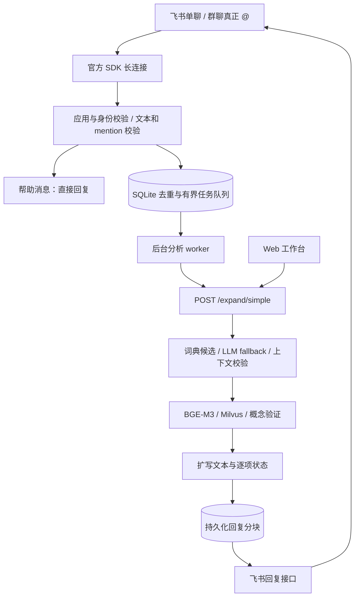

<div align="center">



# Medical Terminology Standardization Platform & feishu

**在飞书聊天中提交英文临床文本，获得医学缩写扩写与标准概念映射。**

飞书单聊 / 群聊 @ 机器人 · Web 分析工作台 · SNOMED CT / RxNorm · 可复核的结果状态


</div>

## 项目介绍

本项目基于 [Medical NLP V11](https://github.com/LI-opera/medical-nlp-v11)，为现有医学文本处理平台增加飞书聊天入口。使用者可以在机器人单聊中粘贴英文文本，也可以在测试群中真正 @ 机器人提交文本；接入程序调用现有 `POST /expand/simple`，将扩写文本、逐项映射状态和可用的标准概念信息回复到原消息。

Web 工作台继续提供单句分析、Benchmark、错误归因和候选词典审核。飞书接入层负责消息校验、排队、调用与投递，复用后端医学处理逻辑。

**当前范围是医学缩写扩写与概念映射。** 项目名称中的“标准化”不表示已经覆盖整份病例的所有医学实体，也不提供诊断或治疗建议。首版只处理英文纯文本，不处理 Word/PDF、图片、富文本或连续追问。

## 从一条消息开始

1. 在机器人单聊中发送 `帮助`，查看使用说明。
2. 粘贴虚构英文文本，例如 `The patient has SOB and CP.`。
3. 接入层检查租户与测试人员允许列表，消息进入有界队列。
4. 后台调用医学 API，完成缩写候选检索、上下文验证和标准概念映射。
5. 机器人关联原消息回复结果；长结果按编号分段返回。

在群聊中，需要先输入 `@`，**从候选列表选中机器人**，再输入正文。仅输入机器人名称不构成真正的 @；群 ID 与发送者 ID 都必须在允许列表内。

| 示例输入 | 可能的扩写 | 标准化输出 |
| --- | --- | --- |
| `The patient has SOB and CP.` | `shortness of breath`、`chest pain` | 根据实际检索与校验结果返回概念详情，或明确显示暂不编码等状态 |

以上是功能示意，不是本版本飞书完整分析的实测结果。实际输出取决于语境、模型服务及术语库。

## 效果展示与截图位置

原平台的 Web 截图：

<table>
  <tr>
    <td width="50%"><b>单句医学缩写分析</b><br/></td>
    <td width="50%"><b>批量评估与结果复盘</b><br/></td>
  </tr>
</table>

下面为新飞书功能预留图片。将真实截图保存到标注路径，再取消对应图片行的 HTML 注释即可显示。详见 [截图说明](docs/images/feishu/README.md)。

### 截图 01：飞书单聊帮助

> **【待补截图 01】** 展示发送“帮助”以及机器人的完整回复。文件：`docs/images/feishu/01-private-help.png`。

<!-- 上传图片后取消下一行的注释 -->
<!--  -->

### 截图 02：群聊真正 @ 机器人

> **【待补截图 02】** 展示普通消息与真正 @ 机器人的区别，以及 @ 后的帮助回复。文件：`docs/images/feishu/02-group-mention.png`。

<!--  -->

### 截图 03：英文病例片段与分析结果

> **【待补截图 03｜完整分析验收后补充】** 使用虚构英文文本，展示输入、扩写文本与逐项标准化结果；可用长截图保留完整上下文。文件：`docs/images/feishu/03-analysis-result.png`。

<!--  -->

### 截图 04：不确定结果或异常提示

> **【待补截图 04｜可选】** 展示真实出现的 `WITHHELD` 或超时等提示，说明系统如何保留不确定性。文件：`docs/images/feishu/04-status-example.png`。

<!--  -->

## 核心能力

| 层级 | 实现 |
| --- | --- |
| 医学缩写扩写 | primary 词典候选、LLM fallback、上下文 coverage 校验、确定性文本替换 |
| 标准概念映射 | BGE-M3 + Milvus 检索 SNOMED CT / RxNorm，验证与必要时重检索 |
| 飞书入口 | 企业自建应用机器人，官方 Python SDK 长连接接收 `im.message.receive_v1` |
| 访问控制 | 应用、租户、用户校验；群聊额外校验允许群与真正 @ 的机器人身份 |
| 任务控制 | SQLite 持久队列和消息去重，单分析 worker，同一用户最多一个在途分析 |
| 结果投递 | 关联原消息回复，UTF-8 分块，稳定 uuid；可重试投递错误最多尝试三次 |
| 可复核状态 | 保留后端状态，区分标准概念代码与内部 concept_id，不生成缺失编码 |
| 评估工作台 | Benchmark、错误分析、fallback 候选人工审核与词典回写 |

默认正文上限 4,000 字符、等待队列 10、待回复任务上限 50。回复积压达到上限时，新消息会被丢弃并在本机记录 `reply_backlog`，需要恢复后重新发送。该版本面向小范围测试，尚未实现多实例或高并发部署。

### 状态如何理解

| 状态 | 含义 |
| --- | --- |
| `CODED` | 后端返回已映射的标准概念 |
| `WITHHELD` | 扩写完成，但暂不编码 |
| `NOT_EXPANDED` / `ABSTAIN` | 无法可靠扩写或放弃判断，需要复核 |
| `OUTCOME_UNKNOWN` | 后端请求超时、网络异常或运行中断，无法确认后端是否完成 |
| `DELIVERY_FAILED` | 结果投递未完成，不等于医学分析失败 |

接入层不自动重跑超时的分析。重启时，已保存结果只继续投递；中断中的分析标为结果不确定。投递去重并不构成网络故障下“绝对恰好一次”的保证。

## 系统架构



长连接免去了公开事件回调地址的配置，但运行接入程序的电脑仍需联网访问飞书；医学后端还需访问其配置的模型服务。飞书仅接入 `/expand/simple`，不会自动触发 Benchmark 或词典审核操作。

## 快速开始

以下以 Windows PowerShell 为例，所有命令从仓库根目录执行。飞书接入与医学后端使用独立 Python 环境。

### 1. 准备医学后端

在新部署环境中，准备 Python 3.12、Docker Desktop、DeepSeek API Key。复制模板并填写后端凭证：

```powershell
Copy-Item backend/.env.example backend/.env
# 在 backend/.env 中填写 DEEPSEEK_API_KEY 后启动
docker compose up -d --build
docker compose ps
# 仅在新建演示库时执行；已有数据库先核对目标
docker compose exec api python tools/milvus/create_milvus_db.py
```

打开 `http://127.0.0.1:8000/app`。演示版只有 5,000 条 SNOMED 数据，不包含完整 RxNorm；完整术语库需要另行准备有权使用的数据并建库。首次模型下载、镜像构建和 LLM 调用需要网络，模型调用可能产生费用。

已有本机 API 的用户可继续使用实际地址，例如 `http://127.0.0.1:8001`。`/health` 只能说明 API 在线，不能证明 Milvus 和模型可用。详细后端说明见 [backend/README.md](backend/README.md)。

### 2. 安装飞书独立环境并做离线测试

```powershell
py -3.12 -m venv integrations/feishu/.venv
.\integrations\feishu\.venv\Scripts\python.exe -m pip install -r integrations/feishu/requirements.txt
Copy-Item integrations/feishu/.env.example integrations/feishu/.env
.\integrations\feishu\.venv\Scripts\python.exe -m unittest discover -s integrations/feishu/tests -v
.\integrations\feishu\.venv\Scripts\python.exe -m integrations.feishu.sdk_check
```

安装依赖需要联网；测试使用隔离替身，不发送飞书消息、不调用付费模型。SDK 检查不建立飞书连接。

### 3. 创建飞书应用并配置身份

创建企业自建应用、添加机器人能力，配置单聊接收、群聊 @ 接收和回复消息权限；订阅 `im.message.receive_v1`，选择长连接，按后台提示发布应用。

在 `integrations/feishu/.env` 填写以下配置：

| 字段 | 来源 |
| --- | --- |
| `FEISHU_APP_ID` / `FEISHU_APP_SECRET` | 飞书应用凭证 |
| `FEISHU_ALLOWED_TENANT` | 登记输出的 tenant_key |
| `FEISHU_ALLOWED_USERS` | 获准测试人员 open_id，逗号分隔 |
| `FEISHU_ALLOWED_CHATS` | 获准测试群 chat_id，逗号分隔 |
| `FEISHU_BOT_OPEN_ID` | 群登记中仅 @ 本机器人时取得的机器人 open_id |
| `MEDICAL_API_BASE_URL` | 实际后端基础地址，不带 `/app`；默认 `http://127.0.0.1:8000` |

先填应用凭证，再运行登记命令：

```powershell
.\integrations\feishu\.venv\Scripts\python.exe -m integrations.feishu.main check --discovery
.\integrations\feishu\.venv\Scripts\python.exe -m integrations.feishu.main discover
```

`discover` 会联网接收消息，但不回复、不分析。在单聊和仅 @ 本机器人的测试群中发送终端本次生成的 `/register 随机口令`，根据输出填入身份 ID。口令 10 分钟失效；完成后按 `Ctrl+C` 停止登记。

完整逐步说明见 [飞书接入操作手册](integrations/feishu/README.md) 和 [从零开始操作指南](docs/飞书机器人从零开始操作指南.md)。

### 4. 启动与停止机器人

```powershell
.\integrations\feishu\.venv\Scripts\python.exe -m integrations.feishu.main check
.\integrations\feishu\.venv\Scripts\python.exe -m integrations.feishu.main run
```

`run` 会连接飞书并回复消息，也可能继续投递之前保存的待回复结果。先验证“帮助”，再用虚构英文文本验证完整分析。

停止机器人：在运行终端按 **Ctrl+C**。正在进行的 HTTP 请求可能需要等待超时结束。医学 API 和 Docker 依赖独立运行，停止机器人不会停止它们；若本次使用上面的 Compose 启动，可另行执行 `docker compose stop`，保留数据卷。

本项目不注册开机自启。仅查看本地状态可执行：

```powershell
.\integrations\feishu\.venv\Scripts\python.exe -m integrations.feishu.main status
```

## 验证范围

| 内容 | 当前证据与边界 |
| --- | --- |
| 飞书接入逻辑 | 离线测试覆盖校验、去重、队列、状态和错误处理，详见 [离线验证记录](integrations/feishu/OFFLINE_VERIFICATION.md) |
| SDK 兼容性 | SDK 1.7.5 构建与序列化的离线检查；不替代真实权限验证 |
| 单聊 / 群聊帮助 | 已有操作者提供的成功回复截图；群聊截图显示真正 @ 后回复 |
| 英文文本完整分析 | 尚未记录该飞书版本完整端到端验收，待补截图 03 |
| 医学准确率 | 原 V11 的评估不能直接视为飞书版准确率；本版未新增准确率承诺 |

运行帮助成功只证明相应消息通路可用，不代表医学模型、术语库和标准化链路已完成验收。现有 GitHub Actions 工作流检查后端默认测试，飞书离线测试通过上方命令单独运行。

## 技术栈与目录

| 部分 | 技术 |
| --- | --- |
| 飞书接入 | Python、lark-oapi 1.7.5、WebSocket 长连接、SQLite |
| 后端 | FastAPI、Uvicorn、Pydantic、LangChain / DeepSeek |
| 检索 | sentence-transformers / BGE-M3、Milvus、SNOMED CT / RxNorm |
| Web | 原生 JavaScript、HTML、CSS，无 React / Vite 构建依赖 |
| 工程 | Docker Compose、unittest、pytest、GitHub Actions |

```text
├─ integrations/feishu/  # SDK 入口、配置、事件校验、任务队列、回复与测试
├─ backend/             # 医学 API、缩写扩写、概念映射、评估与测试
├─ frontend/            # Web 分析和评估工作台
├─ docs/images/feishu/  # 飞书演示截图占位说明
├─ docs/                # 架构设计、实施方案、操作指南
├─ examples/benchmarks/ # 示例评估输入
├─ Dockerfile
└─ docker-compose.yml
```

`backend/graph/` 保留 LangGraph 实验实现，当前 API 主入口不经过该实验流程。

## 数据、配置与后续方向

仓库包含源码、配置模板和演示数据；不包含真实 `.env`、飞书身份配置、任务状态库、运行日志、完整术语库、模型权重或本机虚拟环境。任务正文在本地 SQLite 中临时保存，清理策略详见接入手册；后端自身日志也需按使用环境管理。

- [ ] 完成飞书英文文本端到端验收并补充真实截图。
- [ ] 增加更清晰的消息卡片呈现与人工复核入口。
- [ ] 评估服务器部署、监控与更高并发的需求。
- [ ] 将全医学实体识别、文件处理和连续追问作为独立扩展设计。

更多资料：[原 V11 仓库](https://github.com/LI-opera/medical-nlp-v11) · [V11 架构设计](docs/V11系统架构设计.md) · [飞书接入实施方案](docs/飞书机器人接入项目实施方案.md)。

当前未指定开源许可证。术语数据和模型分别遵循各自的许可与使用条件。
