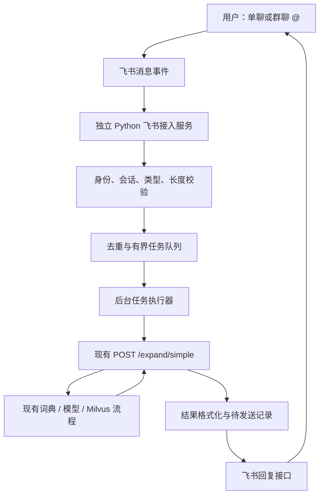

# Medical NLP 飞书机器人接入项目实施方案

版本：V1.0  
编写日期：2026-10-21  
状态：方案已编写；实施 NOT_STARTED；飞书真实联调 NOT_VERIFIED。  
适用项目：`E:\Work\B_RAG\Try\medical-nlp` / `LI-opera/medical-nlp-v11`。

## 1. 目标与已确认需求

用户在飞书与机器人单聊，或在群聊中 @ 机器人后粘贴英文临床文本，机器人调用现有 Medical NLP 后端，并将扩写文本、概念映射和处理状态回复到原会话。

| 项目 | 已确认内容 |
|---|---|
| 会话入口 | 同时支持单聊与群聊 @ 机器人 |
| 输入 | 粘贴英文纯文本 |
| 多轮对话 | 不需要追问解释，每条输入独立处理 |
| 飞书基础 | 用户已有账号，能够进入开放平台创建自建应用 |
| 部署 | 尚未决定；本方案比较 Windows 本机与服务器 |
| 医学能力范围 | 用户尚未决定，第一阶段建议复用现有缩写扩写与概念映射能力 |
| 本轮交付 | 实施方案文档，不代表已完成开发、发布或运行验证 |

建议推进顺序：本机完成接入和小范围真实验证 → 测量性能与资源 → 决定是否迁移服务器。第一阶段同时实现两种聊天入口，不把群聊拖到未定义的后续阶段。

## 2. 先明确“标准化”的范围

### 2.1 第一阶段采用现有能力

当前主链路以医学缩写为处理对象：发现候选缩写 → 扩写与语境校验 → 对应概念检索与验证 → 输出可靠编码或保留失败状态。它可以接收文本，但不能因此承诺覆盖整份病例里的全部医学实体。

例如 `The patient has SOB and CP.` 可以进入现有缩写处理流程；一份没有缩写、包含疾病、药品剂量、检验值和病史时间的病例，不能因为返回了原文就被宣称“全部标准化成功”。所有示例均用于说明交互，不作为实际医学处理结果。

第一阶段明确不包含：全文通用实体识别、否定/时间/主体关系的完整抽取、病历结构化、剂量规范化、文件上传、OCR、语音、多轮解释、自动诊断、自动回写词典或自动提交人工审核候选。

### 2.2 全文实体标准化作为独立扩展

若之后需要完整病例标准化，先定义实体类型、跨度、重复实体、否定语境、时间、患者/家属主体、药品与剂量、单位等数据契约，再建设提取与标准化链路以及标注评估集。该扩展属于医学处理能力建设，不能通过增加一个飞书入口完成。

扩展的启动条件：明确目标实体类型及可接受错误；提供合法可用、已脱敏的代表性数据；制定独立准确性评估；另外估算成本与工期。本方案的接入工期不含这部分。

## 3. 当前代码基础与差距

本节依据 2026-10-21 的本地静态代码检查，未启动服务，未调用模型，未检查飞书账户实际配置。

| 已有基础 | 代码位置 | 可复用内容 / 边界 |
|---|---|---|
| 文本分析接口 | `backend/api/main.py` 的 `POST /expand/simple` | 接收 `text`，返回扩写、概念与状态；当前为同步业务处理 |
| 请求和响应模型 | `backend/api/schemas.py` | `ExpandRequest`、`SimpleExpandResponse`；请求当前未定义文本长度上限 |
| 主处理服务 | `backend/services/abbr_service.py` | 沿用词典、检索、校验、反思链路 |
| 逐项结果 | `mapping_states` | 包含 abbreviation、expansion、source、status、chosen_concept、coverage、failure 等信息 |
| 简化概念列表 | `standardized_entities` | 包含 concept_id、concept_name、concept_code、domain_id、score；当前未显式输出 vocabulary_id |
| 关联标识 | `request_id`、`X-Frontend-Request-Id` | 可关联飞书任务与后端调用；历史请求头名称暂作为兼容字段使用 |
| 存活检查 | `GET /health` | 仅确认 API 进程在线；模型和 Milvus 首次请求初始化，不等于业务就绪 |
| 部署基础 | `docker-compose.yml`、`Dockerfile` | API、Milvus、etcd、MinIO，另有数据与模型缓存挂载 |
| 前端 | `frontend/` | 保留网页入口，机器人不依赖 React 或 Vite |

当前尚无飞书接入模块。需要新增事件接收、调用适配、任务状态、结果格式化、飞书发送、去重和运维说明。

部署前需要专项核查：Compose 当前向宿主机映射 API 8000、Milvus 19530/9091；已有配置示例使用本地开发 MinIO 默认凭据。不能直接照搬为公网生产配置。现有 Dockerfile 会复制整个 backend，构建前应核对 `.dockerignore`，避免把本机 `.env`、日志或业务数据打入镜像。

## 4. 总体架构与技术选择



采用企业自建应用的机器人能力。飞书负责接收和展示消息，接入程序负责调度，现有项目负责医学处理。第一阶段不增加另一个大模型，不使用 Agent 自由选择工具，不需要飞书多维表格、工作流或额外前端站点。

建议使用飞书官方 Python SDK `lark-oapi` 的长连接接收事件。由运行中的接入程序主动建立连接，适合本机验证；具体接收配置和 SDK 支持版本在 P1 按官方文档及开发者后台确认。服务同时需要能够通过 HTTPS 调用飞书消息接口。若组织网络不允许长连接，再另行评估公网 HTTPS 事件回调及其签名验证、挑战应答与网关部署。

接入服务作为独立进程或容器，通过内网 HTTP 调用 Medical NLP API。这样机器人断线或重启不会要求网页服务一起重启，也不把模型初始化放进事件接收回调。SDK 版本在实施时验证并锁定，不在方案中凭空指定最新版。

第一阶段使用单接入实例、单任务执行器和 SQLite 状态库；本机与服务器均沿用相同业务代码。SQLite 位于本地持久化磁盘，不放网络共享目录。只有测得吞吐不足且后端并发安全得到验证，才考虑增加 worker；多实例需引入跨实例任务与锁机制，不直接复制容器扩容。

## 5. 用户交互约定

### 5.1 单聊

允许范围内的用户发送非空英文文本即可启动一次独立任务。机器人回复“已收到，正在排队/处理”，处理完成后回复结果。不把上一条消息作为本条上下文。

`帮助` 或 `/help` 展示用途、长度限制和输入示例，且不调用模型。纯图片、文件、语音等不进入分析，返回“当前仅支持粘贴英文文本”。解析富文本消息不纳入第一阶段；若飞书客户端实际粘贴产生 `post` 消息，则提示改用纯文本并在联调中记录，后续另加结构化提取。

### 5.2 群聊

机器人被加入获准的内部测试群，且用户真正 @ 当前机器人时才触发。必须依据事件中的 mentions 身份数据匹配机器人身份，不能只搜索文字中有没有机器人名字。只移除已确认的 @ 占位符，保留英文正文、标点与换行；仅 @ 无正文则提示补充文本。

未 @、@ 其他人、机器人自己发出的消息以及其他机器人的消息均不触发。以原消息 ID 回复，固定在原群和原消息关联关系中，不将结果发送给固定管理员或另一会话。群内回复对群成员可见，使用说明中明确这一点；需要私密处理的用户使用单聊。

首版范围为应用所在组织内的可用会话；外部群、跨组织用户及特殊群类型是否支持，以实际应用配置和官方规则验证，不能默认承诺。

### 5.3 结果展示

先实现可靠的文本或富文本结果，后续视觉卡片不作为首版阻塞条件。展示顺序：

1. 任务编号、处理完成/部分未能编码等摘要。
2. 扩写后的英文全文。
3. 每项缩写、扩写、概念名称、明确可识别的编码与状态。
4. 无法可靠处理的项目及简明原因。

| 后端状态 | 飞书显示 | 展示要求 |
|---|---|---|
| CODED | 已映射到标准概念 | 同时检查对应概念字段是否存在 |
| WITHHELD | 扩写完成，暂不编码 | 不把检索候选作为已确认编码 |
| NOT_EXPANDED | 未能可靠扩写 | 保留原缩写，不编造解释 |
| ABSTAIN | 本项放弃判断，需复核 | 如实反映已有 failure 信息 |
| PENDING | 后端结果尚未完成 | 不显示为已成功编码 |
| 未知值/缺失 | 状态未识别 | 保留任务编号供排查，避免当作成功 |

使用 `mapping_states` 展示所有项目，包括失败项目；不能只遍历成功列表。`success=false` 可能是业务上的部分失败，不等于 HTTP 或系统故障。没有目标缩写时显示“未识别到可处理的目标缩写”，不宣布全文已标准化。

`concept_id` 与 `concept_code` 分开展示；未获明确词汇表标识时，不根据名称猜测 SNOMED/RxNorm。可以先显示“概念代码 / 内部概念 ID”；若产品确需词汇表名称，先核实数据来源，再在后端契约中显式补字段并做兼容验证。检索 score 不展示成“医学正确概率”。

长结果按段落拆分成编号消息，重申任务编号，保持每项映射完整；内容按纯文本/富文本字段转义，防止输入中的标记被渲染成 @ 或链接。分块阈值应按发送接口的实际字节限制和 SDK 序列化开销验证，不能仅按中文字数猜测。第一阶段不静默截断结果，不额外上传结果文件。

## 6. 接收、排队与可靠性设计

### 6.1 快速接收，后台执行

事件回调只做轻量校验、持久化任务和入队，不等待模型推理或飞书回复网络请求。目标回调耗时 P95 小于 1 秒，最终硬限制以平台接收事件文档核验；“已收到”是一条用户消息，不等同于向平台确认事件处理。

持久化成功后才确认接收。数据库不可写时不能假装任务已接收；返回或异常处理必须按锁定 SDK 的事件重投机制实现和测试。后台执行器读取任务，调用后端，再把结果交给发送器。

### 6.2 去重键与状态

以 `app_id + tenant_key + message_id` 建唯一约束，另记录 event_id。相同消息重投不重复调用模型；用户手动重新发送的另一条消息视为新请求。去重记录建议保留 7 天，作为项目默认值而非平台承诺。

建议任务状态：`QUEUED → RUNNING → RESULT_READY → DELIVERED`；异常分支为 `REJECTED`、`FAILED`、`OUTCOME_UNKNOWN`、`DELIVERY_FAILED`。数据库保存 job_id、消息/会话/发送者身份、状态、时间、后端 request_id、脱敏错误码和发送分块记录。

输入和结果是业务数据，不应混入一般日志。为支持进程重启，待处理任务暂存输入，结果待发送期间暂存输出；发送完成立即清除正文，仅保留必要元数据。未完成正文最长保留 24 小时，超时后清除并标记过期。服务器使用磁盘加密或等效保护，数据库文件限制服务账号访问。SQLite 的 WAL、备份和删除后残留也要纳入保留策略；删除行不等于所有存储副本已安全擦除。

### 6.3 超时与重复执行边界

当前后端没有持久任务查询和请求幂等契约。HTTP 请求超时并不表示后端已停止，自动再发一次可能导致重复模型调用。

- 调用后端：第一阶段不自动重试可能已进入处理的分析请求；网络超时标记 `OUTCOME_UNKNOWN`，告知用户处理结果未能确认。
- 重启恢复：未启动的 QUEUED 可以恢复；进程中断时 RUNNING 变为 OUTCOME_UNKNOWN，不盲目重跑；RESULT_READY 只继续发送已保存结果。
- 后端已经返回的业务拒绝状态：照实展示，不为了得到 CODED 循环请求。
- 飞书回复失败：可只重试发送，不重新执行医学分析。429 按平台建议退避；凭证或权限错误暂停并告警，不能无限重试。
- 发送后连接断开但未收到确认：使用官方接口支持的幂等参数（若所选回复方式支持），并按任务与分块持久化发送状态；若无法确定已发送，记录为投递不确定，不宣称绝对不会重复回复。

第一阶段目标是控制重复执行风险，不承诺跨网络故障的“恰好一次”。如果后续需要强恢复，单独建设后端异步任务提交、查询、幂等键与取消机制。

### 6.4 初始限制与调参

以下是建议初值，需在 P4 用实际耗时调整，不是现有已验证性能：

| 参数 | 建议初值 | 说明 |
|---|---|---|
| 文本长度 | 4,000 字符 | 先验证短段落；超长明确拒绝，不直接切段损失语境 |
| 同时分析任务 | 1 | 先验证后端全局服务对象和资源占用 |
| 等待队列 | 最多 10 个任务 | 满时提示稍后重试，避免无限排队 |
| 每用户未完成任务 | 最多 1 个 | RUNNING/排队均计入，防止单人占满 |
| 排队最大等待 | 300 秒 | 过期后不再启动分析 |
| 后端连接超时 | 5 秒 | 独立于推理等待 |
| 后端读超时 | 暂定 180 秒 | 需根据首次初始化、长输入及 P95 调整 |
| 发送重试 | 最多 3 次，指数退避加抖动 | 遵循平台限频，记录发送状态 |

初始 worker 只约束机器人自身，不能约束网页或 Benchmark 同时使用后端。真实验证期间隔离这些负载；正式运行若共用后端，需统一入口限流或部署独立实例，不能据机器人队列推断全局并发安全。

## 7. 飞书后台配置步骤（面向首次接入）

| 步骤 | 用户操作 | 完成标志 / 排查点 |
|---|---|---|
| 1 | 登录飞书开放平台，创建企业自建应用 | 取得应用名称和 App ID；记录所属组织 |
| 2 | 在应用能力中添加机器人 | 能配置机器人名称、头像和描述 |
| 3 | 获取 App Secret，仅写入本机受保护配置 | 不发聊天、不入 Git；检查机器人程序读到变量但不输出值 |
| 4 | 开通单聊接收、群聊 @ 接收、机器人发送所需权限 | 按事件与接口页面勾选最小权限 |
| 5 | 在事件与回调中配置长连接，订阅接收消息事件 | 事件名为 `im.message.receive_v1`；按后台提示配合启动客户端 |
| 6 | 将应用可用范围限定测试成员，创建版本并发布 | 若组织要求审核，等待管理员处理；记录实际状态 |
| 7 | 在飞书搜索机器人并打开单聊 | 输入框可用；发送帮助能回复 |
| 8 | 将应用机器人加入获准测试群 | @ 本机器人收到提示；普通消息不触发 |
| 9 | 使用虚构英文文本进行业务联调 | 后端请求与飞书结果能关联到同一任务 |

待 P1 核对的最小权限名称：单聊读取 `im:message.p2p_msg:readonly`、群聊 @ 接收 `im:message.group_at_msg:readonly`、应用发消息 `im:message:send_as_bot`。权限可能存在名称变化或可替代历史权限，以当前后台和对应接口说明为准；不为方便而申请读取全部群消息、通讯录或云文档权限。

后台配置与程序启动有依赖：部分配置可能需要先识别到有效长连接。操作手册应描述“先填本机凭证 → 启动连接 → 回后台保存订阅 → 发布”的实际顺序，并以用户当前界面复核。账号能进入开放平台，不代表权限已经生效或应用已经对测试成员发布。

## 8. 模块拆分与拟变更文件

下列路径为实施建议，当前尚未创建相应代码。

```text
integrations/feishu/
  main.py                 启动入口与关闭处理
  config.py               凭证、地址、额度、允许范围
  events.py               事件解析、消息类型、@ 身份校验
  jobs.py                 有界队列、执行与恢复策略
  store.py                SQLite 任务/去重/发送状态
  medical_client.py       调用现有分析接口
  formatter.py            真实状态与字段映射、结果分块
  sender.py               飞书回复、限频与投递记录
  requirements.txt        锁定接入依赖
  .env.example            占位符配置
  Dockerfile              轻量接入镜像，不携带模型与病例
  README.md               配置、运行、排查、升级步骤
tests/feishu/             隔离测试与合成事件样例
docs/                    接入方案与真实验收记录
```

按实际实现复杂度可以合并模块，避免为形式拆分。后端核心医学逻辑默认复用；只有兼容性核查发现契约缺口才提出明确补丁。

拟配置项：`FEISHU_APP_ID`、`FEISHU_APP_SECRET`、`FEISHU_BOT_OPEN_ID`（若所选事件校验方案需要）、`FEISHU_ALLOWED_TENANT`、`FEISHU_ALLOWED_USERS`、`FEISHU_ALLOWED_CHATS`、`MEDICAL_API_BASE_URL`、`MAX_INPUT_CHARS`、`MAX_QUEUE_SIZE`、`MEDICAL_TIMEOUT_SECONDS`、`STATE_DB_PATH`。

默认限制应用租户、测试人员和测试群；允许列表为空时拒绝启动或拒绝处理，不能隐式放行全部。机器人自身身份通过平台返回或受保护配置确定，不能硬编码昵称。

后续需更新 `.gitignore` 排除状态库、WAL/SHM、运行日志与本机配置；增加部署示例和 README 入口。复用 HTTP 调用库前核对项目环境，飞书 SDK 与后端重依赖分开安装，减少依赖冲突。

## 9. 本机与服务器部署比较

| 维度 | Windows 本机 | 独立服务器 |
|---|---|---|
| 适合阶段 | 首次开发、个人或小范围演示 | 团队持续使用 |
| 可用时间 | 受开机、休眠、网络和 Docker 状态影响 | 可配置持续运行与重启恢复 |
| 新增资源成本 | 主要是现有电脑资源、电费与模型调用 | 服务器、磁盘、备份及模型调用 |
| 运行方式 | 后端沿用现有本机/Compose；接入独立 Python 环境 | 建议 Linux + Compose，接入单独轻量容器 |
| 模型与数据 | 复用已准备的本机数据与缓存 | 需迁移或重新构建模型缓存、概念库与词典 |
| 运维要求 | 防休眠、启动顺序、断网恢复 | 日志、磁盘、备份、密钥、健康检查、升级回退 |
| 外网入站 | 长连接方案原则上不需要业务回调公网入口，P1 核实网络条件 | 同样可使用长连接，仅开放必要管理入口 |
| 数据边界 | 病例仍经过飞书与既有模型提供方，并非完全离线 | 同左，另增加服务器存储与访问管理 |

### 9.1 本机操作规划

1. 使用既有环境检查，确认 Docker、模型缓存、Milvus collection、词典与环境变量；不自动重建现有数据库。
2. 后端 API 与依赖先启动；确认 API 存活，再用获准的合成输入完成一次业务探测。
3. 在独立环境安装接入依赖，填占位配置并启动长连接。
4. 单聊、群聊分别验证；再验证断网和接入重启。
5. 若需要开机自启，另行配置隐藏运行的计划任务/服务并记录关闭方式；本方案不实际启动任务。

本机地址区分：接入运行在宿主机时调用 `http://127.0.0.1:8000`（若使用当前 Compose）；接入与 API 均在同一 Compose 网络时调用 `http://api:8000`。容器中的 localhost 指容器自身，不能直接照抄宿主机地址。

### 9.2 服务器选择与上线规划

暂不指定某个套餐或承诺低配服务器足够。整个项目包含 BGE-M3、PyTorch、Milvus、数据和缓存，容量不能只按“一个机器人”估计。

先测模型加载和一次请求的内存峰值、空闲内存、CPU、数据/索引/缓存/日志磁盘空间、冷启动与热请求耗时，再预留增长和系统余量。记录 CPU 型号、内存、磁盘类型、可用容量和网络出口；若使用 GPU，另测显存需求。服务器应能访问飞书、所选模型 API，且具备模型获取方式。

上线配置：使用内部容器网络；不向公网开放 Milvus、MinIO、etcd；API 默认不公开，网页远程访问如有需要另做鉴权和 HTTPS。替换开发凭据，限制管理端口；配置持久化卷与只读代码镜像；在适当位置配置存活与业务就绪探测，不能单靠 depends_on 判定服务已准备好。

备份范围为词典、必要概念数据/索引恢复资料、配置模板和版本信息；任务正文默认不进入长期备份。数据库迁移或重建前保存可恢复备份，禁止以清空 Docker volume 作为常规部署步骤。

## 10. 数据、权限与日志

本项目涉及临床文本，设计需说明实际数据流：用户 → 飞书 → 接入服务 → Medical NLP → 现有模型服务/检索依赖 → 飞书结果。不能因为在本机启动就宣称所有内容只留在本机。

第一轮测试使用合成或已脱敏文本。真实病例是否可以进入飞书和模型服务，由使用方根据实际数据授权和组织规则确定；本方案不替代这项判断。

接入日志只记录任务标识、会话标识的必要形式、耗时、状态、长度和错误码，不记录正文、凭证、授权头或完整事件。SDK Debug 日志及异常堆栈需检查是否包含请求内容；现有后端 `LOG_TEXT_PREVIEW=false` 只能控制对应预览逻辑，不能据此断言全部模型日志都已脱敏。P2 必须检查后端原始输出日志、错误日志与保存结果的路径。

App Secret 和模型 Key 只存在运行环境或受保护配置中；泄露时轮换凭证并重启接入。按租户、用户与群 ID 验证访问，不接受消息内容指定 API 地址、目标会话或执行命令。

## 11. 分阶段任务、交付与验收

阶段工期为单人实施粗估，不包含权限审核等待、完整词库建设、服务器采购、全文实体能力扩展；根据 P0/P1 发现的问题修订。每阶段完成后先记录证据，再进入下一阶段。

| 阶段 | 主要工作 | 交付物与完成条件 | 预计投入 |
|---|---|---|---|
| P0 范围与基线 | 固定首版能力、合成样例、接口字段、部署现状 | 范围记录、输入输出样例、未验证清单 | 0.5 天 |
| P1 飞书通道 | 自建应用、最小权限、官方 SDK、单聊/群聊事件与帮助回复 | 两种入口可接收；无 @ 不触发；记录权限与版本 | 0.5–1 天 |
| P2 接口适配 | 校验、分析客户端、真实状态展示、分块 | 用隔离后端样例验证成功/部分失败/空结果；日志检查完成 | 1–1.5 天 |
| P3 可靠性 | 持久化、去重、限流、恢复、超时与投递失败 | 重复事件仅执行一次；重启不盲目重跑未知任务 | 1–1.5 天 |
| P4 本机真实验收 | 真实飞书、实际后端、合成英文文本、故障场景与测量 | 单聊/群聊证据、耗时/资源记录、问题清单 | 0.5–1 天 |
| P5 部署交付 | 按选定方式部署、自启、备份、手册与回退演练 | 运行手册、版本、凭证位置说明、回退记录 | 本机 0.5 天；服务器 1–2 天 |

合计粗估：本机首版约 4–6 个工作日，服务器交付约 4.5–7.5 个工作日。它是计划值，不是对当前服务性能、审批速度或开发完成日期的承诺。

角色分工：用户负责飞书组织内的创建、权限/发布操作和测试使用范围，开发负责接入实现、配置模板、测试和运行手册。需要管理员审批时由有权限者处理；所有密钥留在本机配置，不要求贴进聊天。

## 12. 验收用例与证据要求

| 编号 | 场景 | 预期 |
|---|---|---|
| A01 | 单聊合法英文文本 | 只产生一个分析任务，结果回原单聊 |
| A02 | 群聊真正 @ 本机器人并附正文 | 正文去除对应 @，结果回原群并关联原消息 |
| A03 | 群聊无 @、@ 别人、机器人消息 | 不调用医学接口 |
| A04 | 空文本、仅 @、不支持的消息类型 | 明确提示，无模型调用 |
| A05 | 超过文本上限 | 明确提示限制，不静默截断 |
| A06 | 相同事件重复/并发投递 | 唯一约束生效，分析调用计数为 1 |
| A07 | 用户自行发两条不同消息 | 按限流规则处理，不错误合并为同一任务 |
| A08 | CODED/WITHHELD/NOT_EXPANDED/ABSTAIN 混合 | 每项状态和概念与后端一致，失败项不丢失 |
| A09 | 无目标缩写、缺字段、未知状态 | 不误报全文成功，不伪造编码 |
| A10 | API 不可用或响应超时 | 有明确失败/结果不确定状态，不自动重跑分析 |
| A11 | 飞书发送 429/网络故障/无权限 | 有界重试或停止；分析不重复；可定位投递状态 |
| A12 | 任务进行中重启接入 | 排队可恢复；运行中标记不确定；现成结果仅继续发送 |
| A13 | 两用户、两群、交错请求 | 会话和结果不串线，原消息关联正确 |
| A14 | 队列满、同人重复提交 | 按限制提示，无无限堆积 |
| A15 | 结果超长、多分块、特殊字符 | 顺序正确，缺块可识别，文本不产生意外 @ |
| A16 | 不在允许范围的用户/群/租户 | 不进入分析，记录脱敏拒绝信息 |
| A17 | 健康接口返回 ok 但 Milvus/模型不可用 | 业务探测能发现问题，不标记全面就绪 |
| A18 | 凭证与数据检查 | Git、镜像、普通日志均无密钥或测试正文泄露 |

测试层次：先单元/契约测试（合成事件、模拟后端、无外部消息），再获准测试应用中的真实链路验证。真实验收至少覆盖成功与未可靠编码两类结果，保留匿名截图、时间、版本、job_id/request_id 关联和调用计数。模拟用例通过只证明接入逻辑，不证明飞书已发布或医学结果准确。

工程验收检查“结果是否忠实传递”，医学准确性沿用现有评估并单独报告。建议记录至少 10 条有代表性的合成输入：目标缩写明确、缩写有歧义、多个缩写、无缩写、接近长度上限；样本量只用于流程验收，不作为医学准确率结论。

证据状态：代码完成记为 IMPLEMENTED_NOT_ACCEPTED；真实场景验证后只对已覆盖范围记为 ACCEPTED；未测场景保留 NOT_VERIFIED。不要用测试数量代替实际使用验收。

## 13. 成本、性能和运行维护

成本构成：模型输入/输出 token、服务器与磁盘（若有）、备份存储、网络以及维护投入。接入层本身不增加模型推理；但重复请求、后端反思和长文本可能增加调用量。沿用模型提供方当期价格和实际 usage 统计，未查询账户套餐前不承诺飞书功能免费或报价。

估算公式：月模型成本 = 所有实际调用的输入 token 费用 + 输出 token 费用；月总成本再加服务器等固定开销。用一批代表样本测平均/高分位耗时、调用次数及 token 后，按日请求量推算；不能直接用“消息条数 × 单次模型价格”，因为一条文本可能触发多次模型调用。

最低运行指标：长连接在线状态、接收/拒绝/重复事件数、队列长度、分析耗时与超时数、业务状态分布、发送失败、磁盘剩余空间。将“连接在线”“API 存活”“业务可用”分别记录。

故障排查顺序：飞书权限/发布/可用范围 → 接入连接与允许列表 → 任务状态 → API 可达性 → Milvus/模型配置 → 飞书发送权限与限频。涉及凭证的日志不直接复制传播。

升级先停止接收新业务并等待或标记在途任务，再备份必要状态，升级并用合成文本验证。回退时停止新版本接入，恢复上一版代码/配置和兼容状态库；保留已发送记录，防止回退后重复发消息。取消或停用机器人时关闭接入进程/容器和自启项；无需清空现有词典或向量数据库。

## 14. 实施前尚需落实的事项

以下可在对应阶段确定，不阻碍本方案成立：

- P0：认可第一阶段仅接入现有医学能力；确定合成验收样例。
- P1：真实应用 ID、机器人身份、测试人员及测试群、实际权限与发布结果。
- P2：锁定 SDK 版本、消息字节上限、可用的发送幂等参数、后端失败字段映射。
- P4：当前电脑资源和实际数据集、后端可用性、长度/超时合理值。
- P5：本机持续运行还是服务器；如选服务器，提供真实规格与网络条件后再定容量。

首个可执行工作包为 P0：整理现有接口契约和合成样例，然后进入 P1 配置测试应用。方案编写本身不代表允许付费模型调用、向真实用户发消息或部署生产服务。

## 15. 来源与核验边界

本地已检查：`backend/api/main.py`、`backend/api/schemas.py`、`backend/services/abbr_service.py`、`backend/.env.example`、`docker-compose.yml`、`Dockerfile`、`.gitignore`。当前项目状态的结论来自源代码，不来自实际服务运行。

官方参考（2026-10-21 查询）：

1. [飞书消息能力总览](https://open.feishu.cn/document/uAjLw4CM/ukTMukTMukTM/reference/im-v1)：接收消息事件及发送/回复能力。
2. [接收消息事件](https://open.feishu.cn/document/server-docs/im-v1/message/events/receive)：实施时核对消息字段、权限和事件规则。
3. [回复消息接口](https://open.feishu.cn/document/server-docs/im-v1/message/reply)：实施时核对正文限制、参数、幂等与限频。
4. [官方 Python SDK 仓库](https://github.com/larksuite/oapi-sdk-python)：Python SDK、鉴权、事件分发与 WebSocket 客户端能力。
5. [Python SDK 处理事件](https://open.feishu.cn/document/uAjLw4CM/ukTMukTMukTM/server-side-sdk/python--sdk/handle-events)：事件接收实现参考。
6. [长连接接收事件配置](https://open.feishu.cn/document/server-docs/event-subscription-guide/event-subscriptions/event-subscription-configure-/choose-a-subscription-mode/request-url-configuration-case)：在 P1 通过可访问的官方页面/开发者后台复核。

资料可访问性说明：消息总览及官方 SDK 仓库内容可读取；若干官方详细文档未返回可提取正文，长连接配置页本次读取失败。因此权限标识、事件确认时限、单条消息大小与详细界面顺序列为实施前复核项，没有把第三方教程当作正式规格。本文的队列、保留期、超时和工期均为项目建议值。
